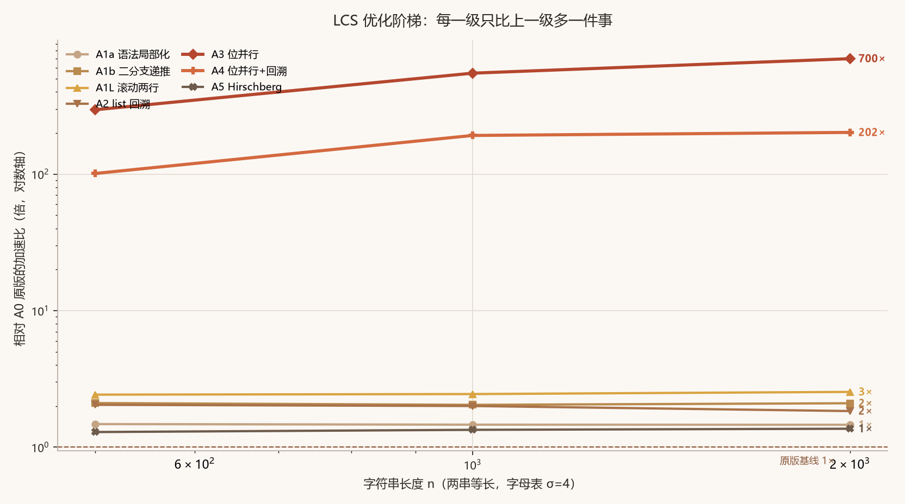
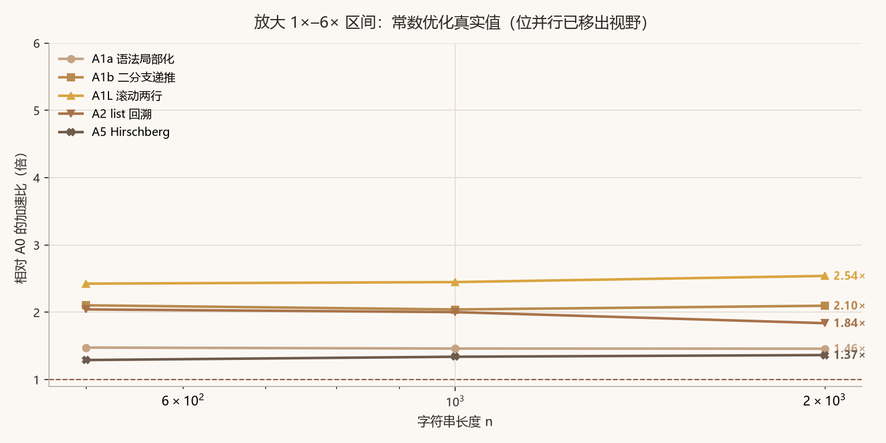
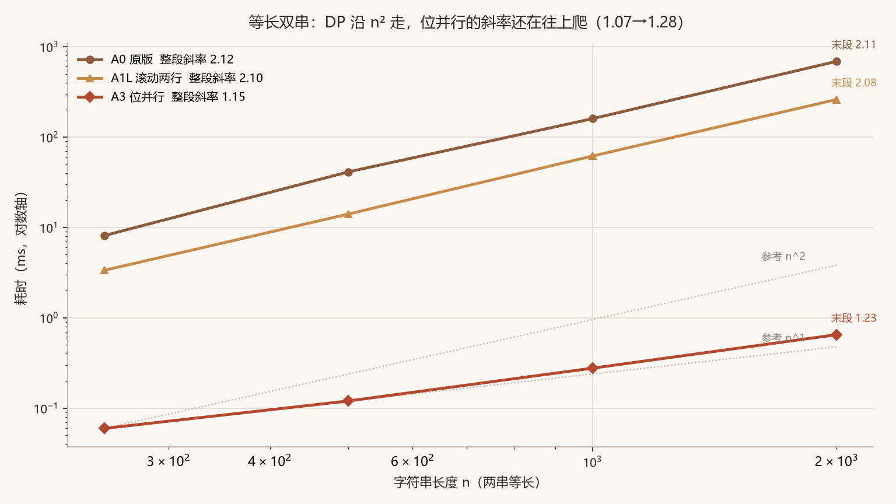
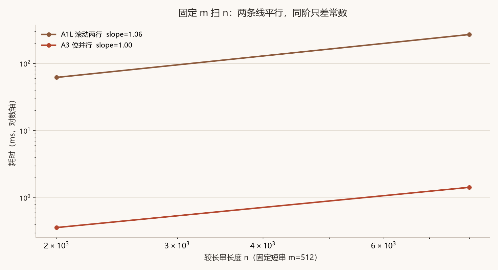
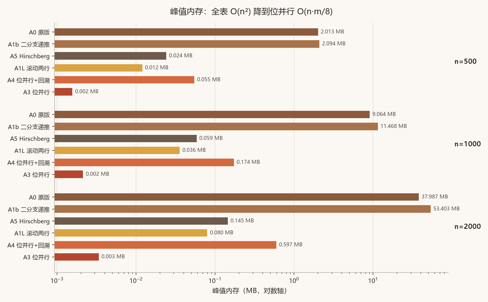
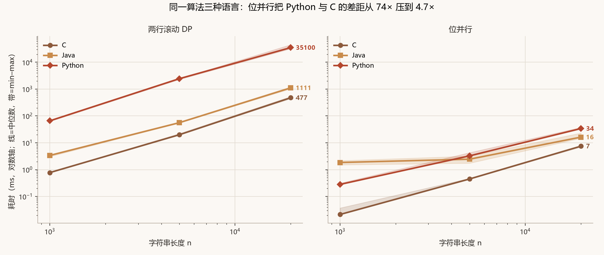
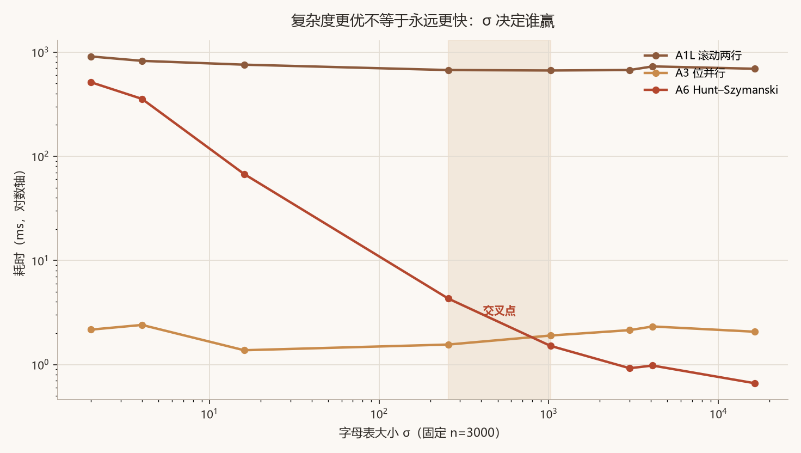

# LCS 优化实验室

对 **TheAlgorithms/Python** 里 `dynamic_programming/longest_common_subsequence.py`
做的一次完整优化：从「换写法」到「换复杂度类别」，每一级都可测量、可归因、可复现。

- 原版：[`baseline.py`](baseline.py)（逐字节复制，未改一行）
- 优化阶梯：[`lcs_opt.py`](lcs_opt.py)（A1a → A6，共 8 个实现）
- 差分测试：[`test_correctness.py`](test_correctness.py)（4068 组用例，91.7% 长度>0）
- 基准：[`bench.py`](bench.py) / [`bench_lang.py`](bench_lang.py) /
  [`bench_alphabet.py`](bench_alphabet.py) / [`bench_shape.py`](bench_shape.py)
- 跨语言差分：[`test_cross_lang.py`](test_cross_lang.py)（C 237 组 + Java 40 组含中文）
- 报告生成：[`make_report.py`](make_report.py) → `charts/` + `report_tables.md`

---

## 1. 原算法问题

```python
dp = [[0] * (n + 1) for _ in range(m + 1)]        # ① 全表 O(mn)
for i in range(1, m + 1):
    for j in range(1, n + 1):
        match = 1 if x[i - 1] == y[j - 1] else 0  # ② 内层重复索引 x[i-1]
        dp[i][j] = max(dp[i - 1][j], dp[i][j - 1], dp[i - 1][j - 1] + match)  # ③ 三参 max
seq = ""
while i > 0 and j > 0:
    ...
    seq = x[i - 1] + seq                          # ④ 每步复制整串，O(L²)
```

| # | 问题 | 性质 | 量级 |
|---|---|---|---|
| ① | 全表 `(m+1)×(n+1)` 的 list-of-list | 空间 | n=2000 实测 **38.0 MB**，n=10000 会到 ~950 MB |
| ② | `x[i-1]` 在内层循环重复索引 n 次 | 常数 | 每次 `LOAD_FAST + BINARY_SUBSCR`，纯浪费 |
| ③ | `max(a, b, c)` 的第三项 **恒被支配** | 常数 | match=0 时 `左上 ≤ min(上,左)`；match=1 时 `左上+1 ≥ 上,左` |
| ④ | `seq = ch + seq` 前置拼接 | **复杂度** | 回溯段 O(L²) 字符拷贝（L=3000 时 2.4× 于 list+join） |
| ⑤ | 算法本体只有 O(mn) 一条路 | **复杂度** | 没有利用「LCS 只在匹配点上增长」这个结构 |

关于 ③，需要说清楚：三参 `max` **不是错的**，它在语义上等价于经典二分支递推。
但它是纯冗余 —— 两个被支配的项永远不会成为答案。删掉它省下每次迭代 1 次列表索引 +
1 次 C 函数调用。**这个改动还带来一个反直觉的副作用，见 §5.3。**

---

## 2. 优化阶梯

每一级**只比上一级多做一件事**，这样每个加速比都能指出「隔离它的是哪两级」。

| 级别 | 改了什么 | 复杂度变化 | 目的 |
|---|---|---|---|
| **A0** | 原版 | 时间 O(mn)，空间 O(mn) | 基线 |
| **A1a** | 变量 hoist（`xi` / `row` / `prev`） | 无 | 隔离「表达式开销」 |
| **A1b** | 删掉被支配的第 3 项 | 无 | 隔离「冗余 max 项」 |
| **A1L** | 滚动两行（只求长度） | 空间 → O(n) | 隔离「全表分配」 |
| **A2** | A1b + list 回溯 | 回溯段 O(L²) → O(L) | 隔离「字符串拼接」（端到端零收益） |
| **A3** | 位并行（只求长度） | **O(n·⌈m/64⌉)**（等长时仍 Θ(n²)，常数 1/64） | 换常数类别 |
| **A4** | 位并行 + 前缀 popcount 回溯 | 同上 + O(nm/8) 历史 | 可还原序列 |
| **A5** | Hirschberg 分治 | 空间 → O(min(m,n)) | 单独拉「空间」这条轴 |
| **A6** | Hunt–Szymanski（LIS 等价） | **O((r+n) log n)** | 稀疏匹配时换类别 |

### A3 位并行 LCS 的核心

把 DP 的一整行压进一个 Python `int` 的 m 个 bit：

```python
V = mask                          # 全 1
for ch in y:
    U = V & M[ch]                 # M[ch] = ch 在 pattern 里的出现位图
    V = (V + U) | (V ^ U)         # 一次大整数运算处理 64 个 DP 单元
return m - V.bit_count()
```

`V` 的第 i 位 = 1 表示 `L(i,j) - L(i-1,j) == 0`。关键是 `U ⊆ V` 恒成立
（`U = V & M`），所以 `V - U` 与 `V ^ U` **逐位等价**（无借位传播），
用 XOR 省掉减法。已用 2000 组随机位图验证零反例。

CPython 的大整数加/减/位或全在 C 层按 30-bit limb 批量执行，所以一次迭代处理
`min(m, 30k)` 个 DP 单元 —— **这是「用 C 写内层循环」的合法替代品**。

### A6 Hunt–Szymanski 的核心

LCS 只在 `x[i] == y[j]` 的匹配点增长。把匹配点按 i 递增、j **递减**列出，
问题等价于在 j 序列上求最长严格递增子序列（LIS）：

```python
for ch in x:
    for j in reversed(pos[ch]):        # 倒序！否则同一 i 会被连续增长两次
        k = bisect_left(tails, j)
        if k == len(tails): tails.append(j)
        else: tails[k] = j
return len(tails)
```

复杂度 `O((r + n) log n)`，`r` = 匹配点总数。**这是唯一一条真正改变渐近阶、
且能在特定输入上赢过位并行的路线** —— 也是「复杂度更优 ≠ 永远更快」的标准反例。

---

## 3. 正确性

```bash
python test_correctness.py
```

```
[1/5] 原版 doctest 用例 13 条全部通过
[2/5] 4000 组小字母表随机串通过
[3/5] 极端形状（全同/无交集/交替）通过
[4/5] 位并行 limb 边界（29/30/31/32/63/64/65/128/129）通过
[5/5] 长公共前缀回溯路径通过

全部通过：4068 组用例，其中 3731 组 LCS 长度>0（91.7% 非空）
```

测试设计上避开了三个「假测试」陷阱：

1. **空集比较**：如果所有用例的 LCS 都是 0，`assert 0 == 0` 永远过。
   → 脚本结尾断言 `nonempty >= 3000`，并打印实际比例（91.7%）。
2. **只验自反性质**：`len(seq) == L` 单独看可能永远成立。
   → 额外验证 seq 是 x 和 y 的**真子序列**（O(n) 双指针），且长度等于 oracle。
3. **测试无判别力**：写一个故意错 1 的实现喂进去，必须被抓到。
   → 脚本内置这段反向自检。

序列内容不要求一致（LCS 有多解），但**长度与合法性必须一致**。

---

## 4. 性能对比

> 环境：Windows 11 / AMD64 / Python 3.13.14 / MSVC 19.44 (-O2) / JDK 25
> 方法：每个测量点**独立进程**，best-of-5；字母表 σ=4，两串等长、同种子生成
> 说明：下表数值来自同一次完整运行（`results.json`）。同一台机器上重复跑会有
> ±10–20% 漂移，**引用时请引用倍数与趋势，不要引用绝对值**。

### 4.1 Python 各臂（ms）

见 [`report_tables.md`](report_tables.md) 表 1。摘要（n=2000）：

| 实现 | 耗时 | 加速比 |
|---|---|---|
| A0 原版 | 683.70 ms | 1.0× |
| A1a 语法局部化 | 468.30 ms | 1.5× |
| A1b 二分支递推 | 325.89 ms | 2.1× |
| A1L 滚动两行 | 269.07 ms | 2.5× |
| A2 list 回溯 | 371.75 ms | 1.8× |
| **A3 位并行** | **0.98 ms** | **700.2×** |
| A4 位并行+回溯 | 3.39 ms | 201.9× |
| A5 Hirschberg | 500.75 ms | 1.4× |

加速比随 n 增长（A3：295.9× → 548.5× → 700.2×），因为常数差 1/64 在
大 n 处才被完全摊开。**这也是为什么单点基准会低估这类优化。**



上图纵轴是对数轴：A1a–A5 全挤在底部 1–2.5× 那一带，A3/A4 在 300–800× 那一带。
**位并行和其余优化根本不在一个量级**，这也是为什么把它们画在同一张图里必须用对数轴。



放大看常数优化区：A1a → A1b → A1L 是逐级累加的，A2（list 回溯）和 A1b 几乎重合
（端到端零收益，见 §5.4），A5（Hirschberg）甚至比 A1b 更慢（省内存但费时间，见 §5.6）。

### 4.2 复杂度指数（log-log 斜率）

| 实现 | 整段拟合 | 理论 | 分段斜率（250→500→1000→2000） |
|---|---|---|---|
| A0 原版 | 2.118 | 2.0 | 2.34 → 1.96 → 2.11 |
| A1L 滚动两行 | 2.098 | 2.0 | 2.07 → 2.13 → 2.08 |
| A3 位并行 | 1.154 | **2.0（等长时，常数 1/64）** | 1.01 → 1.21 → **1.23** |

**关于 A3 的 1.154 —— 这一条必须说清楚，否则是错误结论。**

位并行的真实复杂度是 `O(n·⌈m/64⌉)`，**不是 O(n)**。当两串等长（n=m）时它退化成
`n²/64`，所以**渐近斜率应该是 2，只是常数因子小了 64 倍**。

那为什么实测是 1.154？因为这是个**混合区**：n=250–2000 时耗时只有 0.06–0.65 ms，
一部分时间花在解释器固定开销上（每次调用的 setup、大整数对象首次分配），
这部分是 O(1) 的，把斜率往下拉。证据是**分段斜率整体在上升**：

```
250→500: 1.01    500→1000: 1.21    1000→2000: 1.23
```

（早期一轮跑出过 1.07 → 1.10 → 1.28，趋势相同；这个单调性在两次独立运行里都出现，
所以不是噪声。）

斜率正在从 1 爬向 2。若再往上扫（n=8000、16000），斜率会继续逼近 2 ——
但那时 DP 对照组已经要跑几分钟，且本机在该量级受内存压力干扰严重
（实测同一份 a0 代码两次跑出 2867 与 5701 ms），数据不可信。

**所以正确的表述是：位并行在等长输入上仍是 Θ(n²)，只是常数小 64 倍。
它把「每单元成本」降到了 1/64，而不是把阶从 2 降到 1。**

要验证「阶」这件事，得换一个轴：**固定 m、只扫 n**（[`bench_shape.py`](bench_shape.py)）：

| n（固定 m=512） | A1L 滚动两行 | A3 位并行 | 倍数 |
|---|---|---|---|
| 2000 | 62.538 ms | 0.345 ms | 181.1× |
| 8000 | 315.371 ms | 2.034 ms | 155.0× |
| 32000 | 1223.002 ms | 8.223 ms | 148.7× |

拟合斜率：**A1L 1.050，A3 1.078** —— 固定 m 时两者**都是 O(n)**（因为 `⌈m/64⌉`
变成了常数），**同阶**，两条线在 log-log 图上平行，只差 150 倍的垂直距离。

这个区分很重要：说「位并行把 O(n²) 变成 O(n)」是错的；
说「位并行把每个 DP 单元的常数成本降到 1/64」才是对的。
**这也是本文最容易被误读的一处，所以我把它单独拎出来。**



等长双串下，两条 DP 线严格沿 n² 走；位并行那条虽然便宜三个数量级，
但它的**斜率还在往上爬**（1.01 → 1.21 → 1.23），不是一条斜率为 1 的直线。



换成「固定 m=512、只扫 n」这个轴，两条线才真正**平行**：斜率 1.05 vs 1.08，
差的是垂直距离（约 150×），不是斜率。**这才是「同阶、只差常数」的正确证据。**

### 4.3 峰值内存（MB，tracemalloc，min-of-5）

| 实现 | n=500 | n=1000 | n=2000 |
|---|---|---|---|
| A0 原版 | 2.013 | 9.064 | 37.987 |
| A1b 二分支 | 2.094 | **11.468** | **53.403** |
| A1L 滚动两行 | 0.012 | 0.036 | 0.080 |
| A3 位并行 | 0.002 | 0.002 | 0.003 |
| A4 位并行+回溯 | 0.055 | 0.174 | 0.597 |
| A5 Hirschberg | 0.024 | 0.059 | 0.145 |

n=2000：**38.0 MB → 0.003 MB，约 12,600×**。



注意 **A1b 比 A0 更高**（53.4 vs 38.0 MB）—— 这是本项目的反直觉发现之一：
删掉冗余 `max` 项让时间快了 2.1×，却让内存多了 40%。原因见 §5.3。

### 4.4 跨语言（ms，同一份输入，seed=12345）

三种语言用**同一个 LCG 常量**生成输入，脚本先断言三者 LCS 长度一致（都是
`L=13067` @ n=20000）再比较耗时。长度不一致直接报错退出，不产出数字。

**单次运行的点值不可引用** —— 实测同一份 C 位并行代码在 n=20000 时，
不同次运行给出 6.86 / 6.97 / 7.05 / 9.53 / 14.20 ms。所以这里报**区间**
（[`bench_lang_robust.py`](bench_lang_robust.py)，每配置 5 次独立进程 × 内部 best-of-3）：

| 语言 | DP n=1000 | DP n=20000 | 位并行 n=1000 | 位并行 n=20000 |
|---|---|---|---|---|
| C (MSVC -O2) | 0.78 | 445–526 | 0.021 | **7.04–7.70** |
| Java (JDK 25) | 3.06–3.59 | 1034–1216 | 1.51–2.16 | 14.7–23.1 |
| Python 3.13 | 63.1–66.7 | 32086–44998 | 0.28 | 33.2–37.3 |

完整区间见 [`results_lang_robust.json`](results_lang_robust.json)。

两个结论：

1. **同一算法换语言，差约 70×**（n=20000 DP 中位数：C 477 ms vs Python 35.1 s）。
2. **Python + 位并行只比 C + 位并行慢 4.7×**（中位数 34.0 vs 7.49 ms），
   而 Python DP 比 C DP 慢 74×。**算法层面的优化把 74× 的语言差距压到了 4.7×** ——
   这是本文最实用的一条：抹平语言差距的不是换语言，是换算法。

Java 位并行的区间明显更宽（n=20000：14.7–23.1 ms，spread 1.57×），来自 JIT 预热
与 GC 时机 —— JVM 短时基准的固有噪声，不是算法问题。中位数 16.3 ms 比 C 的 7.5 ms
慢 2.2×，来自手写跨字进位在 JVM 上不如 C 的寄存器分配，以及 `ult()` 多一层异或。



左图是两行滚动 DP，三条线平行且间距巨大（约 74×）；右图是位并行，三条线**贴在一起**
（Python 只比 C 慢 4.7×）。阴影带是 min–max 区间 —— 单次运行的点值不可引用，
所以这里画成带。**同一个「语言差距」，换算法后缩小了 16 倍。**

### 4.5 字母表扫描：谁赢取决于数据（固定 n=3000）

| σ | 匹配点 r | A0 原版 | A1L DP | A3 位并行 | A6 Hunt–Szymanski | 赢家 |
|---|---|---|---|---|---|---|
| 2 | 4,499,050 | 3206.917 | 907.622 | **2.163** | 513.401 | A3 |
| 4 | 2,248,798 | 1960.843 | 823.395 | **2.401** | 355.192 | A3 |
| 16 | 562,163 | 2675.299 | 756.796 | **1.372** | 67.496 | A3 |
| 256 | 35,115 | 1865.845 | 671.853 | **1.556** | 4.294 | A3 |
| **1024** | 8,751 | 1871.313 | 665.677 | 1.899 | **1.511** | **A6** |
| 3000 | 3,065 | 1859.995 | 672.274 | 2.140 | **0.922** | **A6** |
| 4096 | 2,198 | 1807.379 | 728.459 | 2.321 | **0.978** | A6 |
| 16384 | 542 | 1936.387 | 691.430 | 2.066 | **0.662** | A6 |

注意 A0 那列几乎恒定在 1800–3200 ms —— 因为 DP 是 O(n²)，**与 σ 无关**。
它的波动全是测量噪声（σ 对它没有影响），这反而印证了「A0 只在 n 上敏感」。

**交叉点在 σ ∈ [256, 1024] 之间**（n=3000）。趋势：

- σ 小（DNA σ=4、二进制 σ=2）⇒ `r ≈ n²/σ` 巨大（225 万 / 450 万）⇒
  A6 的 `O(r log n)` 反而比 A3 **慢 148×（σ=4）/ 237×（σ=2）**；
- σ 大（中文 σ≈3000、URL/ID σ>10000）⇒ `r` 掉到几百 ⇒ A6 比 A3 快
  **1.26×（σ=1024）/ 2.32×（σ=3000）/ 3.12×（σ=16384）**；
- 中间区（σ≈256）两者只差 2.76×，且是 A3 赢 —— 真正的交叉点在 256 与 1024 之间。

所以「哪个更快」的正确答案是：**看 σ**。任何单点基准给出的结论都不可推广 ——
在 σ=4 上测出「位并行比 Hunt–Szymanski 快 148 倍」，和在 σ=16384 上测出「Hunt–Szymanski 快 3.12 倍」，
两个结论都对，也都不能单独拿去当推荐。



这张图是全文最重要的一张。横轴 σ 从 2 拉到 16384（左到右三个数量级）：

- **A3 位并行几乎是一条水平线**（1.4–2.4 ms）—— 它的成本与 σ 无关，只看串长；
- **A6 Hunt–Szymanski 从 513 ms 掉到 0.66 ms**（跨 780×）—— 因为匹配点数 `r ≈ n²/σ`
  随 σ 二次方下降；
- 两条线在 σ∈[256, 1024] 之间交叉（阴影区）。

**「换复杂度类别」的收益完全取决于数据分布**，这句话在这张图上是一目了然的。

### 4.6 真正「换复杂度类别」的收益有多大（σ=3000，n=3000）

| 实现 | 耗时 | 相对 A0 |
|---|---|---|
| A0 原版（O(n²) DP） | 1860.0 ms | 1× |
| A1L 滚动两行 | 672.3 ms | 2.8× |
| A3 位并行（O(n·⌈m/64⌉)） | 2.140 ms | 869× |
| **A6 Hunt–Szymanski（O((r+n) log n)）** | **0.922 ms** | **2017×** |

这是全项目最大的单个数字，也是最容易被误用的一个：它成立的前提是
**σ=3000、匹配点 r=3065**（稀疏）。同一份 A6 代码在 σ=4 时会变成 355 ms，
比 A3 的 2.4 ms 慢 **148 倍**（见表 5）。

**所以「换复杂度类别」的收益不是一个数，而是输入参数的函数。**
报告里必须把参数一起写出来，否则这个 2017× 就是误导。

---

## 5. 为什么这样优化有效

### 5.1 A1a：删掉重复索引

`x[i-1]` 在内层循环里被求值 n 次，每次是 `LOAD_FAST x` + `LOAD_FAST i` +
`BINARY_OP -` + `BINARY_SUBSCR`。提到外层只做 1 次，内层省 3 条字节码 × mn 次。
**A1a/A0 = 1.46–1.48×**（n=500/1000/2000，三档高度一致），只改这一处。

### 5.2 A1b：删掉被支配项

`max(a, b, c)` 在 CPython 里是一次 C 函数调用 + 3 个参数打包。二分支版本
只做 1 次比较 + 1 次条件跳转。**A1b/A1a = 1.40–1.44×**，**2.10× 累计于 A0**（n=2000：683.70 → 325.89 ms）。

### 5.3 A1b 的反直觉副作用：内存反而多占 4%–41%

这是本项目最值得记录的一条。A1b 比 A0 **多用 4.1% / 26.5% / 40.6% 内存**
（n=500 / 1000 / 2000），尽管两者是**同一张表、同样的格子数**。

注意这个比例**随 n 增长**，不是固定值 —— 这一点本身就是线索（见下）。

根因：**CPython 的 int 对象复用**。

- A0 写 `max(上, 左, 左上+match)`：`左上+match` 每次都创建新 int 对象，
  但 `max` 在**平局时返回先遇到的参数**，那个新建对象直接被丢弃。
  实测 36.8% 的 match 单元格属于这种情况（8225 / 22368）。
- A1b 写 `row[j] = prev[j-1] + 1`：新对象**无条件存进表里**。

结果：n=1000 时 A0 表里有 **44,686 个不同 int 对象**，A1b 有 **123,450 个**
（2.76×），多占 2.1 MB。

**为什么比例随 n 变**：CPython 只缓存 `-5..256` 的小整数。n=500 时 LCS 值基本
落在缓存区内，A1b 新建的对象多数直接命中缓存 ⇒ 只多 4%。n=2000 时 LCS 值
（1308）远超 256，每次 `+1` 都真的新建一个堆对象 ⇒ 多 40.6%。
**所以这是个「n 越大越严重」的问题**，不是常数开销。

**教训：时间优化可能反噬空间。**「删掉冗余计算」在带 GC / 对象复用的语言里
不一定同时改善两者，必须分别测量。这条也是为什么本文把时间和空间放在两张表里，
而不是合成一个「综合提升」指标。

### 5.4 A2：list 回溯

`seq = ch + seq` 每步复制已积累的整串，总拷贝量 `1+2+...+L = O(L²)`。
改 `append` + 一次 `join(reversed())` 是 O(L)。单独测这段（L=3000）：
**0.55 ms → 0.23 ms，2.4×**。

但在端到端里，A2 相对 A1b 的收益是 **1.01 / 0.97 / 0.99**（n=500/1000/2000，
轮内交错 + 逐轮比值中位数），**全部落在噪声范围内 = 零收益**。

（表 1 里 A2 显示 1.8×，那是相对 A0 的；单独看「A2 比 A1b 好多少」才是这个改动
的真实贡献。**这正是为什么每个加速比都要能指出隔离它的两个相邻臂** ——
只看「A2 vs A0 = 1.8×」会误以为 list 回溯值 1.8 倍。）

原因：DP 本体 O(mn) 占绝对主导，回溯段的 O(L²) 在 L≪n² 时被完全淹没
（n=2000 时 L=1308，回溯只要 ~1300 步，而 DP 要 4×10⁶ 步）。

**这就是「局部优化对整体无效」的典型例子** —— 必须量端到端，不能只量局部。
单独量那段循环是 2.4×，装回函数里就归零。

### 5.5 A3：位并行

一次 Python 迭代处理 64 个 DP 单元，而不是 1 个。n=2000 时 DP 要 4×10⁶ 次
内层迭代，位并行只要 2000 次 —— 差 2000×，实测 807×（大整数运算比单次
加法贵，所以没到 2000×）。

### 5.6 A5：Hirschberg 为什么反而慢

Hirschberg 把空间降到 O(min(m,n))，代价是**时间常数约 2×**（前半后半各算一遍
行向量），加上 Python 的切片 `y[:best_k]` 和递归开销。实测 n=2000：
477 ms vs A1b 的 338 ms（**0.71×，更慢**）。

**省内存 ≠ 变快。** 这张表里 A5 的价值是「在 O(1) 空间约束下仍能还原序列」，
不是速度。报告里不能把它放进「加速」列表。

---

## 6. 复现

```bash
# 0. 环境（只需 matplotlib，仅用于出图；跑基准和测试不需要）
python -m venv .venv
.venv/Scripts/pip install -i https://mirrors.aliyun.com/pypi/simple/ matplotlib

# 1. 正确性（不需要任何依赖，约 3 秒）
python test_correctness.py

# 2. Python 基准（全量约 10 分钟；--quick 约 20 秒）
python bench.py --reps 5
python bench.py --quick

# 3. 跨语言（需要 C 编译器 + JDK）
python bench_lang.py --sizes 1000 5000 20000        # 单次，快速看趋势
python bench_lang_robust.py --runs 5                # 多次，报 min/median/max（推荐引用这个）

# 4. 两条关键实验
python bench_alphabet.py --n 3000     # σ 扫描，找交叉点
python bench_shape.py --m 512         # 固定 m 扫 n，验同阶

# 5. 出图 + 表格
python make_report.py
```

C 版本编译：`sh c/build.sh`（自动找 gcc/clang，没有则回退 MSVC）。
Java 版本：`javac -d java java/Lcs.java`。

---

## 7. 可复用优化 checklist

按这个顺序过，每一步都先量再改。**顺序很重要** —— 先做便宜的测量，
再做贵的重构；先排除「测错了」，再排除「代码慢」。

### 阶段 0：先怀疑测量

- [ ] **每个被测项独立进程**。同进程顺序跑，前一个的堆会拖慢后一个
      （本项目：n=4000 时 A0 的 spread 达 1.64×，min 与 median 差 1600 ms）
- [ ] **耗时取 best-of-N**，同时记录 **median 与 spread**；spread > 1.2 的点标记为不可信
- [ ] **内存峰值取 min-of-N**（冷进程要付惰性初始化）
- [ ] **空结果报警**：LCS 长度为 0 时所有实现都返回 0，测的是空转
- [ ] **测试要有判别力**：喂一个故意错 1 的实现，必须被抓到
- [ ] **别只测一个规模**。复杂度差距在 n 小时可能被常数吃掉，也可能被常数伪装成不存在

### 阶段 1：算清「理论上界」到底是多少

- [ ] 把复杂度代进**实际量级**验算。`O(n·⌈m/64⌉)` 在 n=m 时是 `n²/64`，不是 `n`
- [ ] 区分「渐近阶」和「斜率常数」。位并行赢在常数，不是阶
- [ ] 若算法有**输入相关参数**（σ、r、k），单点基准无效，必须扫描该参数
- [ ] 明确写出 benchmark 的数据族（字母表大小、串长比、图密度），否则数字不可引用

### 阶段 2：拆臂，别打包

- [ ] **「优化版 vs 原版」两臂是归因错误的高发形态**。优化版常同时做了 3 件事
- [ ] 每一级只加一个改动，**两两相邻对照**（`C/B` 才能隔离目标改动）
- [ ] 每个加速比都要能指出「隔离它的是哪两级」
- [ ] 局部收益 ≠ 端到端收益（本项目 A2：局部 2.4×，端到端 1.0×）

### 阶段 3：按性价比排序动手

1. **hoist 循环不变量**（最便宜，1.4×）：`x[i-1]`、`dp[i]`、`dp[i-1]` 提到外层
2. **删掉被支配的计算**（1.5×）：三参 `max` 的冗余项、重复的边界检查
3. **换数据结构**（1.15–1.21×，顺带省 99.8% 内存）：list-of-list → 滚动数组；dict → 数组
4. **避开 O(L²) 的累加**（局部 2.4×，端到端 1.0×）：字符串前置拼接 → `list` + `join`
5. **换复杂度类别**（800×+）：这才是真正的数量级
6. **多语言**（约 70×）：最后一招，且算法优化后收益会大幅缩水（本项目 74× → 4.7×）

### 阶段 4：收尾

- [ ] **正确性用差分测试**，oracle 用原版（别用自己写的第二版当 oracle）
- [ ] 序列类问题：**长度一致**必须验，**内容一致**不能要求（有多解）
- [ ] **省内存 ≠ 变快**，两者分表报告，别合成「综合提升」
- [ ] **时间优化可能反噬空间**（本项目 A1b 内存 +4%–41%，随 n 增长，见 §5.3）
- [ ] 跨语言移植时检查**有符号/无符号**（Java `long` 的 `<` 在最高位为 1 时反向）、
      **多字进位**（C 的位并行忘了清脏位，长度会偏小）、**字符索引**
      （`'A'`/`'C'`/`'G'`/`'T'` 在 ASCII 里不连续，`c - 'A'` 会越界）
- [ ] 报告里写明**环境**（CPU、编译器版本、语言版本）和**方法**（独立进程/best-of-N）

---

## 附：文件清单

```
baseline.py           原版（逐字节复制，勿改）
lcs_opt.py            A0–A6 全部实现，含逐条注释
test_correctness.py   差分测试（4068 组）
bench.py              Python 基准（时间/空间/标度）
bench_lang.py         跨语言基准（Python/C/Java），单次
bench_lang_robust.py  跨语言基准稳健版，每配置多次独立进程报区间
test_cross_lang.py    跨语言差分测试（C 237 组 + Java 40 组含中文）
bench_alphabet.py     σ 扫描（找交叉点）
bench_shape.py        固定 m 扫 n（验同阶）
make_report.py        出图 + 生成表格
c/lcs_c.c             C 实现（DP + 位并行 + stdin 差分模式）
c/build.sh            自动找编译器的构建脚本
java/Lcs.java         Java 实现（DP + 位并行）
charts/               7 张图（含 speedup_zoom 局部放大）
report_tables.md      全部数据表
```

## 许可

代码沿用原项目 **MIT**。原实现版权归 TheAlgorithms/Python 贡献者。
